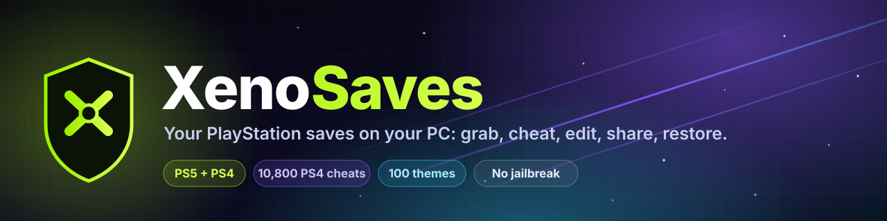
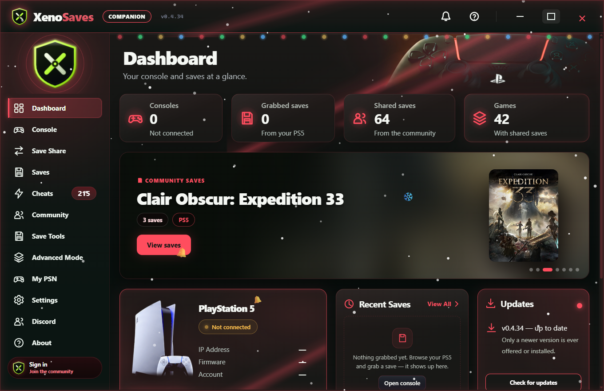
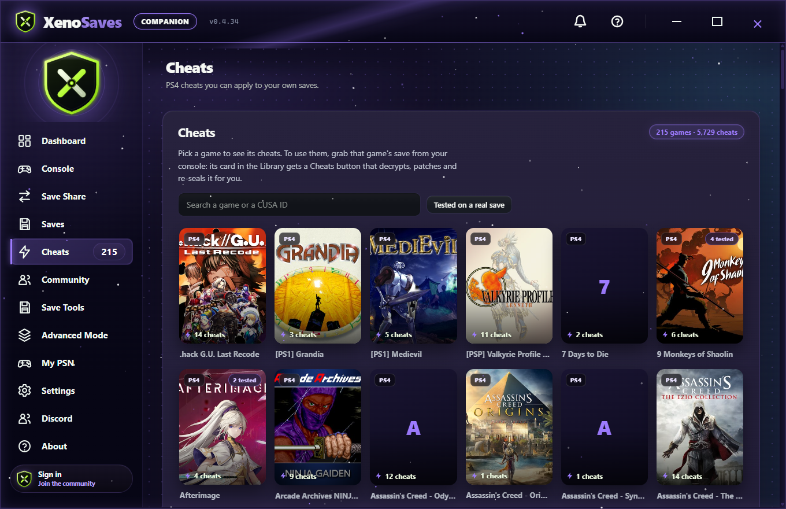
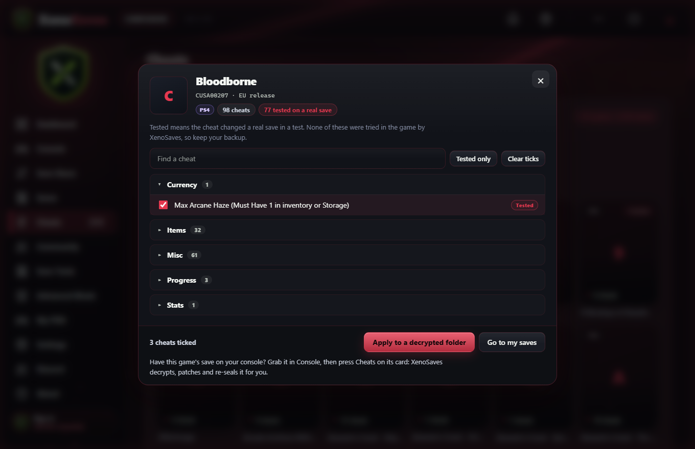
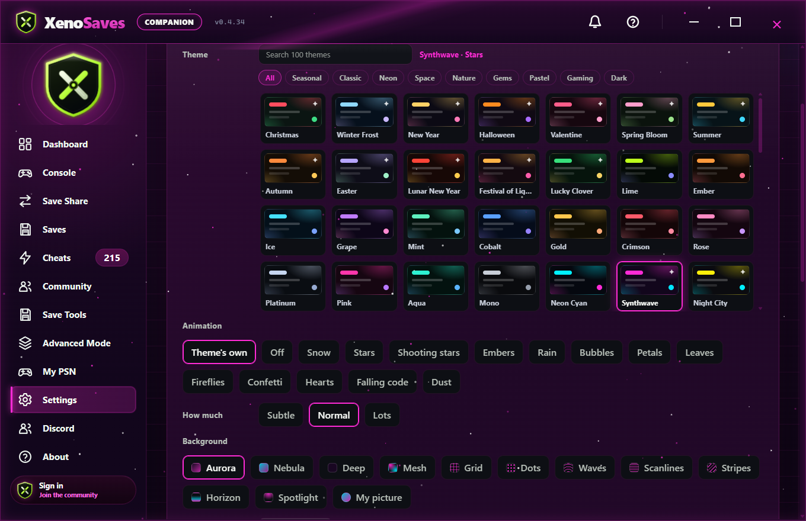
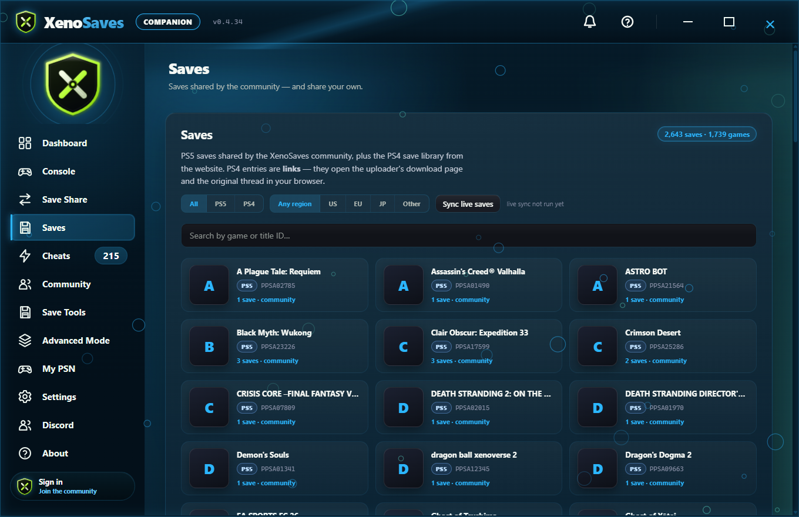
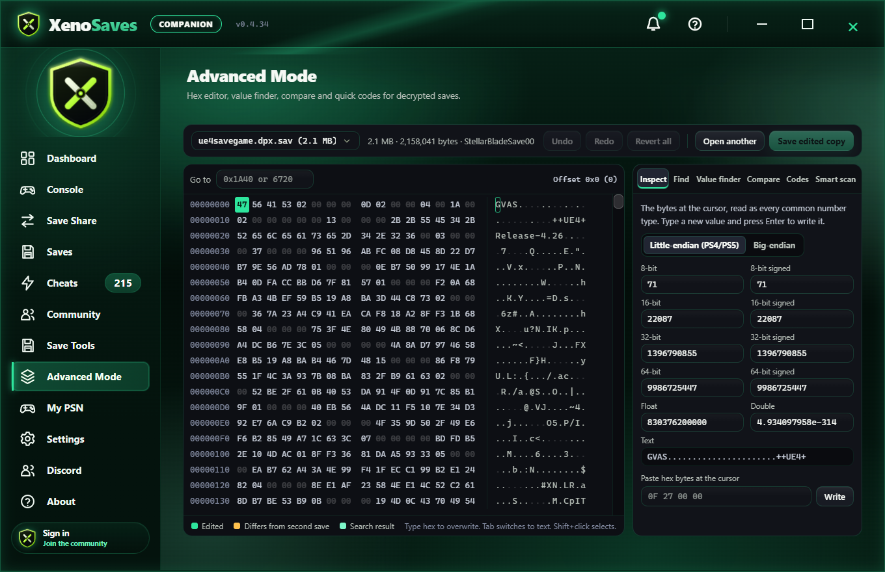
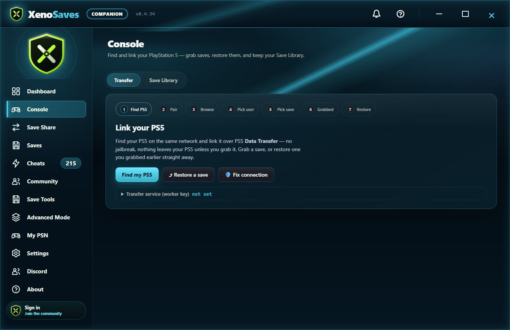

<!-- XenoSaves - PS5/PS4 save manager, cheats, editor and community. Built on GarlicTransfer by earthonion. Credits below. -->

  

### [⬇️ Download](../../releases/latest) &nbsp;·&nbsp; [What it does](#what-xenosaves-does) &nbsp;·&nbsp; [Screenshots](#screenshots) &nbsp;·&nbsp; [FAQ](#faq)

---

## Download

**[Get the latest version here](../../releases/latest).** Take the **Setup** (installer) or the **Portable** build, open it, and you are in. Nothing else to install. Windows 10 / 11, 64-bit.

---

## New in 0.4.34

| | |
|---|---|
| ⚡ **PS4 cheats** | 462 community cheat lists, about 10,800 cheats. Every game is a cover tile. A PS4 save you grabbed from your console gets a **Cheats** button when its game has a list, including lists written for another region's release. Tick what you want, press Apply, and XenoSaves decrypts the save, patches it, fixes its checksums and re-seals it, ready to restore. |
| 🎨 **100 themes** | A searchable gallery in ten groups: Seasonal, Classic, Neon, Space, Nature, Gems, Pastel, Gaming, Dark. A theme recolours the whole app. |
| ❄️ **Animated backgrounds** | Snow, stars, shooting stars, embers, rain, bubbles, petals, leaves, fireflies, confetti, hearts, falling code and dust. Choose how much, or turn it off. |
| 🖼️ **Your own background** | Nine new background styles, or pick a picture of your own. |
| 🎄 **Christmas** | For the season the app switches once to a Christmas theme with falling snow and a string of lights. Change it any time and your choice is kept. |

---

## What XenoSaves does

XenoSaves is a free Windows app for your PlayStation saves. It is built on **[GarlicTransfer](https://github.com/earthonion/GarlicTransfer)** by **earthonion**, which provides the save transfer it runs on.

| | |
|---|---|
| 🎮 **Grab saves from your PS5** | Download your own saves from a normal, fully updated PS5. No jailbreak. Pick the user, then the game. |
| 🔓 **Decrypt, edit, re-seal, restore** | Open a save, change it, seal it again for your own account and send it back to the console. |
| ⚡ **PS4 cheats** | Tick cheats for a grabbed PS4 save and apply them in one go. |
| 🤝 **Save Share** | Take a save someone gave you and sign it for your own account, or re-region it to your release of the game. |
| ✏️ **Advanced Mode** | A hex editor with a value finder, before/after compare, quick codes you can apply or make, and a smart scan that points at money, health, stats and items. |
| 📚 **Community saves** | Browse and download saves grouped by game with cover art, and share your own. A reviewer checks each one before it goes live. |
| 💾 **Library and backups** | Everything you grab is kept on your PC. Your originals are never overwritten. |
| 🎨 **Make it yours** | 100 themes, animated backgrounds, your own picture, fonts and scale. |

> **Straight talk:** XenoSaves never pretends. If a console cannot be reached it says so, and it never fakes a transfer. The PS4 cheats come from the community: the ones marked *tested* changed a real save in a test, and none of them were tried in the game by XenoSaves, so keep a backup of your save.

---

## Screenshots

| PS4 cheats | Tick, apply, restore |
|:--:|:--:|
|  |  |
| **100 themes** | **Community saves** |
|  |  |
| **Advanced Mode** | **Console** |
|  |  |

---

## How a cheat reaches your console

1. **Grab** the game's save from your PS5 in the Console tab.
2. Press **Cheats** on that save in your Library and tick what you want.
3. Press **Apply**. The save is decrypted, patched and sealed again for your account.
4. **Restore** it to the console and load the game.

The save in your Library stays as it was until you restore, and a cheat that does not fit your save changes nothing.

---

## Setup and Portable

| Build | File | For |
|---|---|---|
| **Setup** | `XenoSaves-Companion-<version>-Setup.exe` | A normal install with a Start menu shortcut and an easy uninstall. Recommended. |
| **Portable** | `XenoSaves-Companion-<version>-portable.exe` | Runs from any folder with no install. |

1. **[Download](../../releases/latest)** the Setup or the Portable build.
2. Open it. Windows may warn about a new publisher; the app is code-signed, so choose **More info**, then **Run anyway**.
3. That is all. Make a free account inside the app if you want the community.

---

## Updates

XenoSaves updates itself. It checks when it starts, downloads a new version in the background, verifies it and installs it on the next restart. It never interrupts a save transfer, and only a newer version is ever installed. **Dashboard, then Updates** shows your version and what changed.

---

## Security and privacy

- **No secret ships in the app.** The only key in the download is a public one that cannot change or delete anyone's data. Publishing, approving, moderation and the transfer worker all live on the server and check your account.
- **Tamper-proof build.** The app is code-signed and its program files are integrity-checked; a modified copy refuses to run.
- **Your saves stay yours.** Saves are read on your PC and your original files are never changed. A shared save is published only after you choose to share it and a reviewer checks it.

See [`XenoSaves/SECURITY.md`](XenoSaves/SECURITY.md).

---

## FAQ

**Do I need a jailbroken PS5?** No. Grabbing and restoring your saves works on a normal, fully updated PS5.

**Do the cheats work on PS5 games?** The cheat pack is for PS4 games, including PS4 games you play on a PS5. PS5-game cheats come later.

**My save is from another region than the cheat list. Will it work?** Usually. Releases of one game normally share the same save layout, and XenoSaves tells you when a list was written for another region. A cheat that does not fit changes nothing.

**Is my save safe?** Your original files are never modified. Edits and cheats go into a separate copy, and nothing reaches the console until you restore.

**Do I need to install Python or anything else?** No. The Setup and Portable builds contain everything.

**Is it really free?** Yes.

---

## Troubleshooting

| Problem | Fix |
|---|---|
| Windows SmartScreen warning | The app is signed. Choose **More info**, then **Run anyway**. |
| PS5 not found | Put the PC and the PS5 on the same network and leave the PS5 on its home screen. The app shows the step it is waiting on. |
| A cheat says "not found in this save" | That cheat looks for something your save does not have yet (an item you never picked up, for example), or your game version stores it differently. Your save was not changed. |
| A download fails | Give it a moment and try again. |
| An update will not install | It installs on the next restart, and only when the app is idle. Close the app fully and open it again. |

---

## Credits

XenoSaves stands on other people's work. Thank you.

| | |
|---|---|
| **earthonion** | Creator of **[GarlicTransfer](https://github.com/earthonion/GarlicTransfer)**, the PS5 save transfer XenoSaves is built on. |
| **XENO KING** | Creator of XenoSaves: the app, the editor, the community. |
| **Bucanero and the cheat makers** | The PS4 cheat pack is made of community cheat lists, most of them from **[apollo-patches](https://github.com/bucanero/apollo-patches)** (GPL-3.0) and from Save Wizard quick codes shared by the community. The lists ship as separate, credited data files; the full credits are in the app's cheat pack folder. |
| **Malygos** | Contributor. |
| **Skiller** | Contributor. |

This repository is a fork of **earthonion/GarlicTransfer**. GarlicTransfer's original source is kept here unchanged; see [`XenoSaves/CREDITS.md`](XenoSaves/CREDITS.md) and [`XenoSaves/LICENSES.md`](XenoSaves/LICENSES.md).

---

**Made by XENO KING** · Built on GarlicTransfer by earthonion

