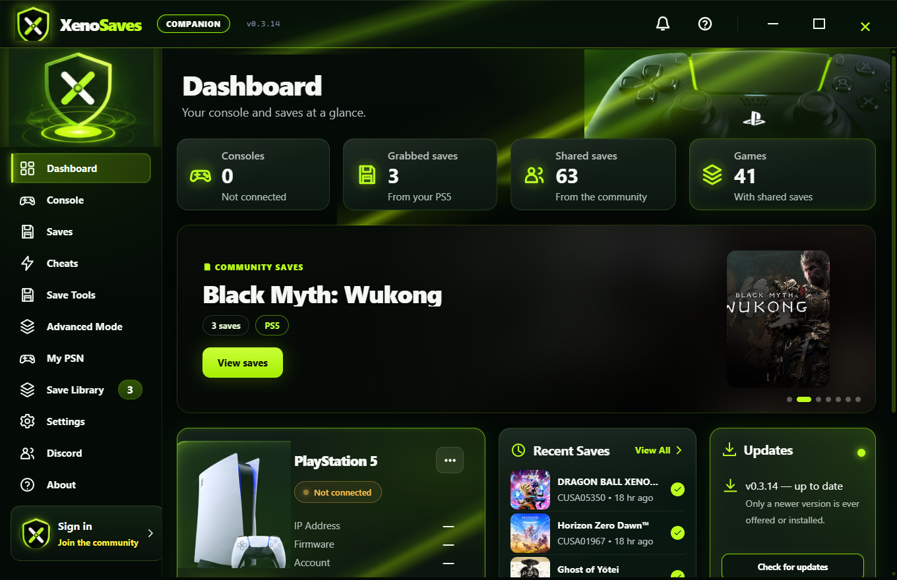
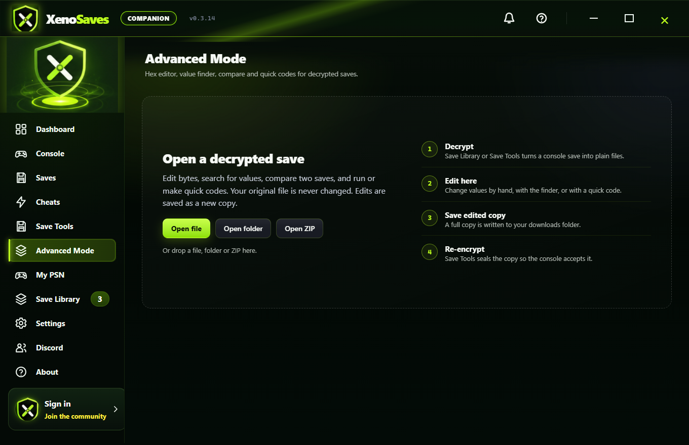
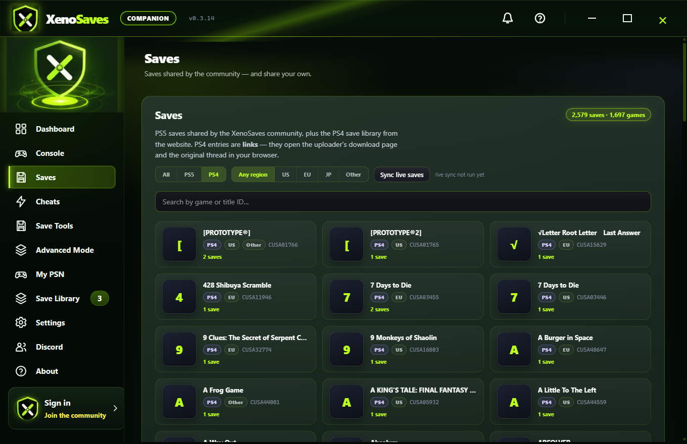
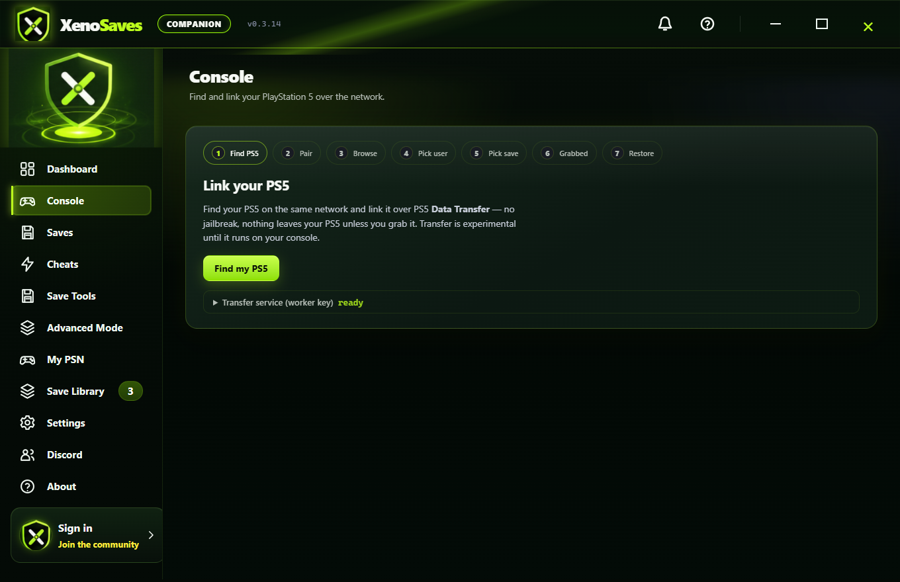
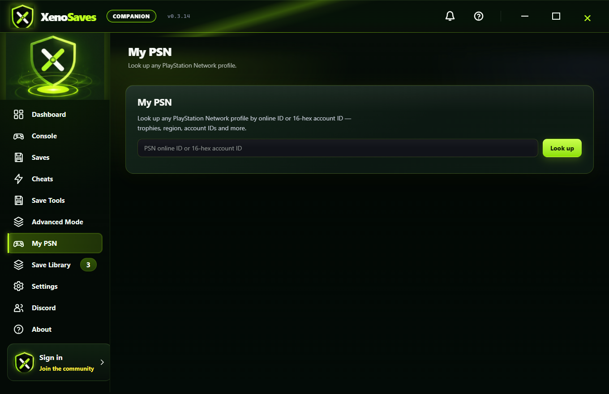

<!-- ╔══════════════════════════════════════════════════════════════════════╗ -->
<!-- ║                 XENOSAVES — PS5/PS4 SAVE MANAGER & EDITOR              ║ -->
<!-- ║   Built on GarlicTransfer by earthonion. Credits below. Be kind.      ║ -->
<!-- ╚══════════════════════════════════════════════════════════════════════╝ -->

 

  

### [⬇️ Download the app](../../releases/latest) &nbsp;•&nbsp; [✨ Features](#-what-xenosaves-does) &nbsp;•&nbsp; [❓ FAQ](#-faq)

---

## ⬇️ Download the app

**[➡️ Download the latest version here](../../releases/latest)** — grab the **Setup** (installer) or the **Portable** build, open it, and you're in. No Python, Node, or developer tools. Windows 10 / 11, 64-bit.

---

## ✨ What XenoSaves does

XenoSaves is a free Windows app for managing, editing and sharing PlayStation saves. It is built on top of **[GarlicTransfer](https://github.com/earthonion/GarlicTransfer)** by **earthonion**, which provides the save-transfer foundation.

| | |
|---|---|
| 🎮 **Grab saves from your PS5** | Download your own saves from a **stock, up-to-date PS5** — no jailbreak — through the GarlicTransfer worker. Pick the user, then the game. *(Verified on real hardware.)* |
| ✏️ **Advanced Mode editor** | A real hex editor: edit bytes, a **value finder** (find where your money/HP is stored), before/after **compare**, and **Save Wizard–style quick codes** you can apply or make. Your original file is never touched. |
| 🧩 **Smart scan** | Finds names in a save that look like money, health, stats, points, items and unlocks — leads you check, never fakes. Optional AI helper. |
| 🤝 **Community saves** | Browse and download a growing collection of PS5/PS4 saves, grouped by game with cover art. Share your own — a reviewer checks it before it goes live. |
| ⚡ **Cheats browser** | A live catalog of PS5 cheats by game. |
| 💾 **Save Library & backups** | Everything you grab is kept locally with timestamps; your originals are never overwritten. |

> **Honest by design:** XenoSaves never pretends. If a console can't be reached, it says so plainly — it never fakes a transfer. Everything listed here is tested and working.

---

## 🖼️ Screenshots

| Advanced Mode (hex editor) | Community saves |
|:--:|:--:|
|  |  |
| **Console (grab saves)** | **My PSN** |
|  |  |

---

## 📦 Setup & Portable

| Build | File | For |
|---|---|---|
| **Setup** | `XenoSaves-Companion-<version>-Setup.exe` | Normal install: Start-menu shortcut, easy uninstall. *Recommended.* |
| **Portable** | `XenoSaves-Companion-<version>-portable.exe` | Runs from any folder, no install. |

1. **[Download](../../releases/latest)** the Setup (recommended) or Portable.
2. Open it. Windows may warn about a new publisher — the app is code-signed; click **More info → Run anyway** if prompted.
3. That's it — the app has everything built in. Make a free account right inside the app if you want the community.

---

## 🔄 Updates

XenoSaves updates itself. It checks on startup, downloads new versions in the background, verifies them, and installs on the next restart — it will **never interrupt a save transfer**. Only a **newer** version is ever installed (no downgrade tricks). You can see the version and what changed in **Dashboard → Updates**.

---

## 🔒 Security & privacy

- **No secret ever ships in the app.** The only key inside the download is a **public** key that cannot change or delete anyone's data. Everything that could be abused — publishing saves, approving, moderation, the transfer worker — lives on the **server** and checks your account. There is nothing in the download for anyone to extract and misuse.
- **Tamper-proof build.** The app is code-signed and its program files are integrity-checked; a modified copy refuses to run.
- **Your saves stay yours.** Saves are read locally; your original files are never changed. A shared save is only published after you choose to share it and a reviewer checks it.

See [`XenoSaves/SECURITY.md`](XenoSaves/SECURITY.md).

---

## 💬 Community

XenoSaves has a built-in community, **right inside the app** — browse and download saves, and share your own. You make a free account directly in the app; no separate sign-up anywhere else. More community features are on the way and arrive automatically through updates.

---

## ❓ FAQ

**Do I need a jailbroken PS5?** No. Grabbing your saves works on a normal, fully-updated PS5.

**Do I need to install Python or anything?** No. The Setup and Portable builds contain everything.

**Is my save data safe?** Yes — your original files are never modified. Edits are written to a separate copy.

**How do I make an account?** Right inside the app — no website needed.

**Is it really free?** Yes.

---

## 🛠️ Troubleshooting

| Problem | Fix |
|---|---|
| Windows SmartScreen warning | The app is signed; click **More info → Run anyway**. |
| PS5 not found | Make sure the PC and PS5 are on the same network and the PS5 is on the home screen. The app shows the exact step it's waiting on. |
| A download fails | Give it a moment and try again. |
| Update won't install | It installs on the next restart, and only when idle. Fully close and reopen the app. |

---

## 🙏 Credits

XenoSaves stands on other people's work. Thank you.

| | |
|---|---|
| **earthonion** | Creator of **[GarlicTransfer](https://github.com/earthonion/GarlicTransfer)** — the PS5 save-transfer foundation XenoSaves is built on. |
| **XENO KING** | Creator of XenoSaves: the app, the editor, the community. |
| **Malygos** | Contributor. |
| **Skiller** | Contributor. |

This repository is a fork of **earthonion/GarlicTransfer**. GarlicTransfer's original source is kept here unchanged; see [`XenoSaves/CREDITS.md`](XenoSaves/CREDITS.md) and [`XenoSaves/LICENSES.md`](XenoSaves/LICENSES.md).

---

**Made by XENO KING** · Built on GarlicTransfer by earthonion

